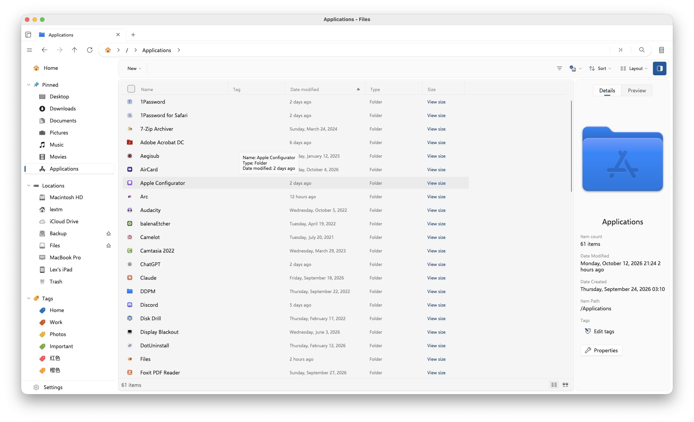

# macOS-Files: Files for macOS

macOS-Files is a macOS port of [Files](https://github.com/files-community/Files), built on the recent Linux port. The goal is to merge this macOS port into the upstream Files (Windows) repository.

<p align="center">
  
</p>

Files is created and maintained by the [Files Community](https://github.com/files-community) and its [contributors](https://github.com/files-community/Files/graphs/contributors). The Linux port ([Uno Platform](https://platform.uno), Skia, X11) is the work of the [LinuxFiles](https://github.com/MemerGamer/LinuxFiles) contributors; the macOS platform layer (AppKit and the macOS platform services) is the work of [LeXtudio Inc.](https://github.com/lextudio).

> [!WARNING]
> **Status: alpha.** Expect missing features and rough edges, and do not rely on it for data you cannot afford to lose. The official, supported Files for Windows is at [files.community](https://files.community/).

macOS-Files is currently not affiliated with the Files (Windows) project or the Linux port. Code changes here follow the original Files MIT/MPL license, and the upstream copyright and contributor notices are preserved.

## macOS port: current state

This port runs Files natively on macOS through Uno Platform (Skia, AppKit). The shell, Settings, file operations, Trash (macOS `~/.Trash`), archives, clipboard and drag and drop, mounted volumes (including eject and Time Machine status), iCloud Drive, Finder tags, network locations (Bonjour) and connected iOS devices are in place.

## Build and run

Requires the .NET SDK; the app targets `net10.0-desktop`.

```sh
dotnet build src/Files.App/Files.App.csproj -c Debug
dotnet src/Files.App/bin/Debug/net10.0-desktop/Files.dll
```

To package a runnable `Files.app` bundle (ad-hoc signed by default):

```sh
scripts/macos/pack-app.sh -o /Applications      # or: -o dist, add --dmg for a disk image
```

For local development with an embedded automation/introspection agent, see `scripts/macos/devflow.sh`.

## Reporting bugs

- **macOS bugs and feature requests:** open an issue in [this repository](https://github.com/lextudio/macOS-Files/issues).
- **Security issues:** use this repository's private [Security Advisories](https://github.com/lextudio/macOS-Files/security/advisories/new). See [SECURITY.md](./SECURITY.md).

## Contributing

Contributions to this macOS port are welcome. See [CONTRIBUTING.md](./CONTRIBUTING.md).

## Credits

- **[Files Community](https://github.com/files-community)** and all [upstream contributors](https://github.com/files-community/Files/graphs/contributors): the Files app, its design, code and translations (via [Crowdin](https://crowdin.com/project/files-app)) that this port is built on. Files is MIT/MPL licensed, Copyright (c) 2018 - present Files Community.
- **[LinuxFiles](https://github.com/MemerGamer/LinuxFiles)** and its contributors: the Linux port (Uno Platform, Skia, X11) and the shared POSIX layer this macOS port is based on.
- **[LeXtudio Inc.](https://github.com/lextudio)**: the macOS platform layer and the macOS port.
- **[Uno Platform](https://platform.uno/)**: WinUI on Skia/AppKit for macOS, which makes this port possible.
- **[SkiaSharp](https://github.com/mono/SkiaSharp)**, **[Selawik](https://github.com/microsoft/Selawik)** (UI font) and **Uno.Fonts.Fluent** (icons).
- **[TagLibSharp](https://github.com/mono/taglib-sharp)**, **[Markdig](https://github.com/xoofx/markdig)**, **[ColorCode](https://github.com/CommunityToolkit/ColorCode-Universal)**, **[LibGit2Sharp](https://github.com/libgit2/libgit2sharp)**, **[SharpCompress](https://github.com/adamhathcock/sharpcompress)**, **[7-Zip](https://www.7-zip.org/)** and the .NET Community Toolkit.

The full list of third-party components and licenses is in [NOTICE.md](../NOTICE.md) and [.github/NOTICE.md](./NOTICE.md). "Files" and its logo are the Files Community's; they are used here to identify the upstream project and its ports, with no endorsement implied.

## License

[MIT](../LICENSE-MIT) and [MPL](../LICENSE-MPL), following the original Files licensing. Copyright (c) 2018 - present Files Community; Copyright (c) 2026 LeXtudio Inc. (macOS port).
